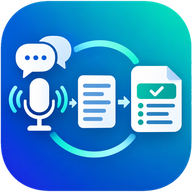

# VTS



Application web (PWA) qui **retranscrit en texte, en temps réel**, ce que capte le micro de votre smartphone.

## Fonctionnalités

- Transcription en direct : les mots s'affichent pendant que vous parlez (en gris), puis se fixent une fois reconnus.
- Écoute continue : relance automatique après les silences.
- Plusieurs langues (français par défaut, anglais, espagnol, allemand, italien, portugais, breton…).
- Copier, partager (menu de partage du téléphone) ou télécharger le texte en `.txt`.
- **Enregistrement au fil de la voix** : chaque phrase reconnue est sauvegardée sur l'appareil
  dès qu'elle est validée, avec son heure. Rien n'est perdu si l'appli se ferme ou si le
  téléphone s'éteint.
- **Historique** (📚) : ➕ démarre un nouvel enregistrement, les précédents restent consultables,
  réouvrables (pour continuer à dicter dedans) ou supprimables.
- Export horodaté en option : `[14:32:05] Bonjour à tous`.
- L'écran reste allumé pendant l'écoute.
- **Écran noir pendant l'écoute** : dès qu'on lance la dictée, l'écran devient entièrement noir
  (discret, et économe en batterie sur les écrans OLED) ; la transcription continue en dessous.
  Un toucher sur le **petit coin gris en bas à droite** réaffiche l'appli. Le bouton **🌑** de
  l'en-tête passe en écran noir à tout moment, enregistrement en cours ou non. Le passage
  automatique au démarrage est désactivable dans ⚙️ Réglages.
- Pour aller à l'écran d'accueil du téléphone sans arrêter l'enregistrement : bouton **Accueil**
  du téléphone (ou balayage vers le haut). L'enregistrement audio continue en arrière-plan sur
  Android ; la dictée en direct se met en pause et reprend au retour dans l'appli.
- Installable sur l'écran d'accueil, thème clair/sombre automatique.

## Traduction simultanée en français 🌐

Choisissez la **langue parlée** dans le menu en haut (ex. *English*), puis cochez
**« 🌐 Traduire en français pendant la transcription »** sous les modes. Chaque phrase reconnue
(dictée en direct ou retranscription d'un fichier son) est traduite dès qu'elle arrive ; la
traduction s'affiche en italique sous la phrase d'origine, et figure dans les exports texte.

Moteur utilisé automatiquement :
1. le **traducteur intégré à Chrome** quand il est disponible (sur l'appareil, gratuit, privé ;
   la langue peut devoir être téléchargée une première fois) ;
2. sinon **Claude**, si une clé API est saisie dans ⚙️ (payant à l'usage, texte envoyé à Anthropic).

Sans l'un ni l'autre, la transcription continue sans traduction (un message l'indique).

## Voix en couleur 🎨

Pendant la **dictée en direct**, chaque voix entendue a sa couleur, avec son nom à chaque
changement d'interlocuteur (« Voix 1 », « Voix 2 »…). Touchez le nom pour le **renommer**
(« Marie ») : le nom est repris dans les exports (« Marie : … ») et transmis à Claude.

L'analyse est faite sur le téléphone, à partir de la hauteur et du timbre de la voix.
C'est une **estimation** : fiable entre voix nettement différentes (voix grave / voix aiguë),
elle peut confondre deux voix proches. Désactivable dans ⚙️ Réglages. Nécessite Chrome à jour.

## Enregistrement audio ⏺️

Choisissez **« ⏺️ Enregistrement audio »** au-dessus du texte, puis appuyez sur le micro.

- Le son est sauvegardé sur l'appareil **toutes les 5 secondes** : si l'appli est fermée ou le
  téléphone s'éteint, l'enregistrement est récupéré à la prochaine ouverture.
- Le fichier est nommé d'après la date et l'heure de début : **`enr_jjmmaaaa_hhmmss`**
  (ex. `enr_02112026_143205.webm` pour un enregistrement lancé le 2 novembre 2026 à 14 h 32 min 05 s).
- À la fin, l'appli propose de **retranscrire** le fichier en texte (la relecture dure à peu près
  la durée de l'enregistrement), puis de créer le **compte-rendu**. Les mots-clés (« Point
  suivant », « Décision », « Action »…) prononcés pendant l'enregistrement sont reconnus.
- Le fichier se réécoute, s'exporte (💾) ou se partage (📤) depuis l'enregistrement, et reste
  dans l'historique 📚.

La retranscription d'un fichier nécessite **Chrome à jour** (Android ou ordinateur). Ailleurs,
l'enregistrement fonctionne mais pas la retranscription du fichier.

## Fichiers 🗂️

Dans 📚, l'onglet **« 🗂️ Fichiers »** liste les fichiers son (`enr_…`) et les comptes-rendus
(`cr_…`) avec leur date et leur heure, du plus récent au plus ancien, filtrables par type.
Cochez un ou plusieurs fichiers (ou « Tout sélectionner ») puis :

- **📂 Importer un son** : ajoute un ou plusieurs fichiers audio choisis dans n'importe quel dossier
  du téléphone (Téléchargements, enregistreur, WhatsApp, Drive…) : MP3, M4A/AAC, WAV, OGG/Opus,
  WebM, FLAC… selon ce que le téléphone sait lire. Le fichier est renommé `enr_jjmmaaaa_hhmmss`
  d'après son heure de début (heure du fichier moins sa durée ; un fichier `enr_…` exporté par VTS
  garde son nom) ; son nom d'origine reste affiché. Fichier illisible ou déjà importé : refusé
  avec un message. Les fichiers importés sont sélectionnés, prêts pour « Retranscrire » ;
- **📝 Retranscrire** (un seul fichier son) : retranscription à la demande du fichier choisi ;
  le texte s'affiche au fur et à mesure, puis l'appli propose le compte-rendu. La liste indique
  pour chaque son s'il est déjà retranscrit (« ✓ texte ») ou non ;
- **👁️ Consulter** (un seul fichier) : aperçu du compte-rendu, ou ouverture du son avec son lecteur ;
- **📤 Partager** : envoi par le menu de partage du téléphone (mail, messagerie, Drive…), les
  comptes-rendus au format Word ; sans menu de partage, les fichiers sont enregistrés dans le téléphone ;
- **💬** (sur chaque ligne) : ajouter, modifier ou effacer un **commentaire** propre au fichier,
  300 caractères au plus. Il s'affiche sous le fichier dans la liste et reste sur l'appareil.
- **🗑️ Supprimer** : après confirmation. Le texte de la transcription est conservé tant qu'il
  reste dans l'onglet Enregistrements.

## Compte-rendu de réunion 📝

Le bouton 📝 transforme la transcription en compte-rendu structuré, modifiable, puis exporté en
document professionnel aux couleurs de votre organisation.

**1. Mots-clés à dicter** (reconnus en début de phrase, affichés en badges colorés) :

| Vous dites | Résultat |
|---|---|
| « Point suivant : budget 2027 » | nouveau point de l'ordre du jour |
| « Décision : on valide le prestataire » | ligne du tableau des décisions |
| « Action : Marie envoie le devis pour vendredi » | action + responsable (Marie) + échéance (vendredi) |
| « Participants : Paul, Marie et Ahmed » | liste des présents |
| « Prochaine réunion : mardi 10 h » | date de la prochaine réunion |

Un mot-clé dit seul, suivi d'une pause, s'applique à la phrase suivante.

**2. Rédaction par Claude (facultatif)** : « ✨ Rédiger avec Claude » envoie la transcription à
l'API d'Anthropic, qui renvoie un compte-rendu rédigé (synthèse, points, décisions, actions).
Il faut une clé d'API personnelle (⚙️ Réglages), facturée à l'usage. Elle reste stockée sur
l'appareil. Relisez toujours le résultat avant diffusion.

**Sans clé API, avec votre abonnement Claude** : « 📋 Copier pour Claude » envoie la consigne et
la transcription vers l'appli Claude (menu de partage, ou copie + ouverture de claude.ai).
Copiez ensuite toute la réponse de Claude, revenez dans VTS et touchez « 📥 Coller la réponse » :
le compte-rendu est rempli automatiquement, prêt pour les exports Word/PDF à votre charte.

**Options Claude** (⚙️ Réglages, actives seulement quand la clé est saisie) :
- **Corriger automatiquement la transcription** : à la fin de chaque dictée ou retranscription
  d'un fichier son, Claude corrige le texte reconnu par le téléphone (ponctuation, majuscules, mots
  mal reconnus), phrase par phrase, sans reformuler ; heures, voix et mots-clés sont conservés.
  Claude ne transcrit pas le son lui-même : la reconnaissance vocale reste celle du téléphone.
- **Rédiger automatiquement le compte-rendu** à l'ouverture de 📝 (sans cliquer sur
  « Rédiger avec Claude »).

**3. Export** : 👁️ aperçu, 📄 PDF (via l'impression du navigateur : « Enregistrer au format PDF »),
💾 Word (.docx modifiable) ou 📤 partage direct du fichier Word. Nom automatique :
**`cr_jjmmaaaa_hhmmss`** d'après le démarrage de la source (fichier son ou dictée),
ex. `cr_02112026_143205.docx` ; c'est aussi la référence indiquée dans le document.

**Charte** (⚙️ Réglages) : nom de l'organisation, logo, couleur principale, rédacteur par défaut,
mention de pied de page. Le document comprend un en-tête avec logo, un tableau d'informations,
des sections numérotées, les tableaux des décisions et des actions, une pagination et, en option,
la transcription intégrale en annexe.

## Utilisation sur smartphone

1. Ouvrez l'adresse de l'appli (en **HTTPS**) :
   - Android : **Chrome** (recommandé)
   - iPhone : **Safari** (iOS 14.5 ou plus)
2. Appuyez sur le bouton micro et autorisez l'accès au microphone.
3. Pour l'installer : menu ⋮ → « Ajouter à l'écran d'accueil » (Android) ou bouton Partager → « Sur l'écran d'accueil » (iPhone).

### Icône et raccourcis

Une fois installée, l'appli apparaît avec l'icône VTS. Sur Android, un **appui long sur l'icône**
propose deux raccourcis : « Nouvel enregistrement » et « Compte-rendu ».

Si l'ancienne icône reste affichée : Android met à jour l'icône d'une appli installée en général
sous 24 h, à l'ouverture suivante. Pour l'avoir tout de suite, désinstallez l'appli (appui long sur
l'icône → Désinstaller) puis réinstallez-la depuis Chrome.

## Mise en ligne

L'appli est 100 % statique (HTML/CSS/JS, aucun serveur). Les bibliothèques `docx` (Word) et
`@anthropic-ai/sdk` (Claude) sont intégrées dans `vendor/` (licence MIT). Le workflow
`.github/workflows/pages.yml` la publie sur GitHub Pages à chaque push sur `main` :
`https://<utilisateur>.github.io/voixtexte/`. Si besoin, activez Pages dans
**Settings → Pages → Source : GitHub Actions**.

Test en local (sur ordinateur) :

```sh
python3 -m http.server 8000
# puis ouvrir http://localhost:8000 dans Chrome
```

## Limites à connaître

- La reconnaissance utilise le moteur vocal intégré au navigateur (Web Speech API). Sur Chrome
  et Safari, l'audio est généralement traité par les serveurs de Google ou d'Apple : **une connexion
  internet est nécessaire**.
- L'appli écoute **le micro** : elle transcrit ce qui est dit autour du téléphone (conférence,
  conversation, haut-parleur…). Un navigateur ne peut pas capter directement le son interne d'une
  autre appli (vidéo, appel) ; dans ce cas, faites jouer le son sur le haut-parleur.
- Firefox ne prend pas en charge la reconnaissance vocale.
